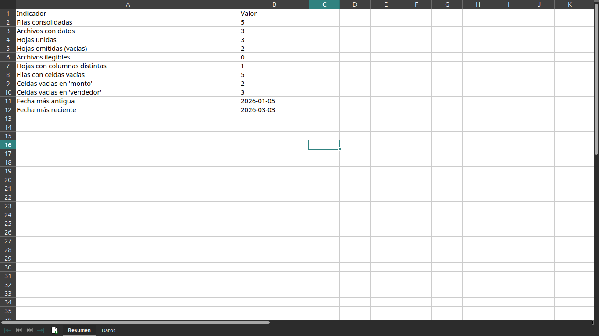

# Automatizaciones con Python

Colección de scripts para automatizar tareas repetitivas:

1. Renombrar archivos en masa
2. Consolidar varios Excel en uno solo
3. Enviar emails personalizados desde una lista

> 🚧 En desarrollo: el script 1 (renombrar archivos) está terminado y listo para usar.
> Los scripts 2 (consolidar Excel) y 3 (enviar emails) están en camino.

## Ejemplo rápido

```bash
# 1. Simulación: ver qué haría SIN tocar nada (empezá siempre así)
python3 scripts/renombrar.py datos_prueba/fotos --prefijo producto --simular

# 2. Renombrar de verdad
python3 scripts/renombrar.py datos_prueba/fotos --prefijo producto

# 3. Renombrar solo algunos tipos de archivo
python3 scripts/renombrar.py datos_prueba/fotos --prefijo producto --extensiones jpg,png
```

## Requisitos

- Python 3.14 (versión usada en este proyecto, compatible con 3.10+).
- Usá `python3` en Linux/Mac y `python` en Windows si `python3` no te funciona. Ambos deben apuntar a Python 3.14.

## Seguridad

- Modo simulación antes de tocar nada.
- No pisa archivos existentes.
- Se puede correr varias veces sin romper nada.
- Ignora archivos de sistema (.DS_Store, Thumbs.db) y maneja errores sin frenarse.
- Permite elegir qué tipos de archivo renombrar.

## Instalación

    python -m venv venv
    source venv/bin/activate    # En Windows: venv\Scripts\activate
    pip install -r requirements.txt

## Uso

### 1. Renombrar archivos en masa

Opciones:

- `--prefijo`: prefijo del nombre nuevo (por defecto `archivo`).
- `--simular`: solo muestra lo que haría, no renombra nada.
- `--extensiones`: renombra solo esos tipos, separados por coma (ej: `jpg,png`).

Resultado:

```text
IMG_4521.jpg  →  producto_001.jpg
documento final.PDF  →  producto_002.pdf

✅ 20 archivos renombrados, 0 saltados.
```

Nombres del estilo `producto_001.jpg`, con la extensión siempre en minúsculas.
Los archivos ocultos (`.gitkeep`, `.DS_Store`) y los del sistema (`Thumbs.db`)
se ignoran, y el script avisa si algún archivo no se pudo renombrar.

### 2. Consolidar varios Excel en uno

Une todas las hojas de todos los `.xlsx` de una carpeta en un solo archivo,
con una hoja `Resumen` que dice cuántos datos entraron y qué quedó afuera:



```bash
# 1. Simulación: ver qué uniría SIN escribir nada (empezá siempre así)
python3 scripts/consolidar.py datos_prueba/reportes --simular

# 2. Consolidar de verdad
python3 scripts/consolidar.py datos_prueba/reportes --salida consolidado.xlsx

# 3. Reporte de cliente con títulos arriba de los encabezados
python3 scripts/consolidar.py datos_prueba/cliente --salida consolidado.xlsx \
    --formato-fecha auto --fila-encabezado 3
```

Opciones:

- `--salida`: nombre del Excel final (por defecto `consolidado.xlsx`).
- `--simular`: solo muestra lo que haría, no escribe nada.
- `--formato-fecha dia|mes|auto`: cómo leer fechas tipo `05/02/2026`.
  `dia` = día/mes (LatAm), `mes` = mes/día (EE. UU.), `auto` lo deduce solo.
- `--fila-encabezado N`: fila donde están los encabezados, por si el reporte
  tiene títulos arriba (ej: `3` = tercera fila). Por defecto 1.

Qué hace el script:

- Lee **todas las hojas** de cada archivo, no solo la primera.
- Omite hojas vacías y avisos legibles si un archivo no se pudo leer:
  nada queda afuera en silencio.
- Avisa si una hoja tiene columnas distintas a las demás.
- Normaliza la columna `fecha`: acepta fechas reales de Excel y texto en
  varios formatos, y las deja como fecha de verdad en el resultado final.
- El Excel de salida trae dos hojas: `Resumen` (indicadores para el cliente)
  y `Datos` (todo el contenido unido, con columnas `origen` y `hoja`).

> 💡 Si el reporte tiene un título en la primera fila, pandas nombla las
> columnas `Unnamed: 1`, `Unnamed: 2`… El script entra igual pero **avisa**
> en pantalla para que uses `--fila-encabezado` con la fila que corresponda.
